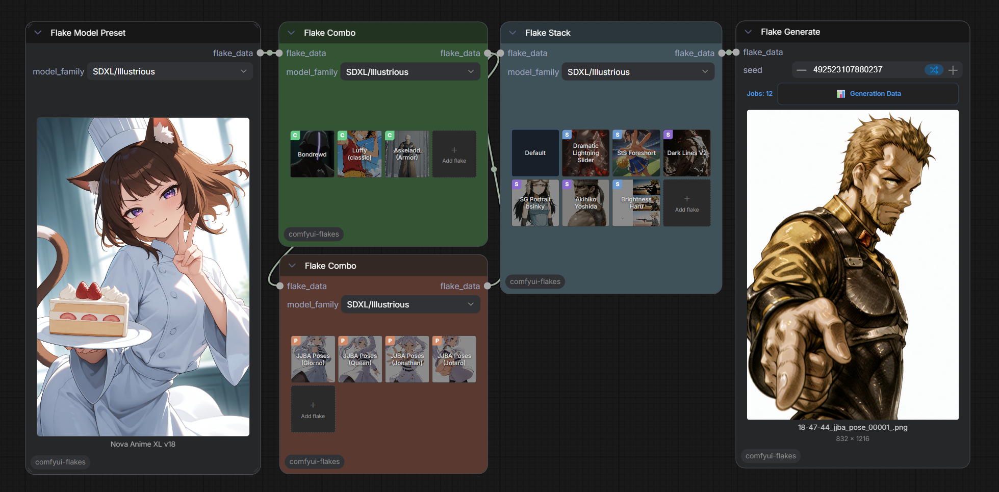
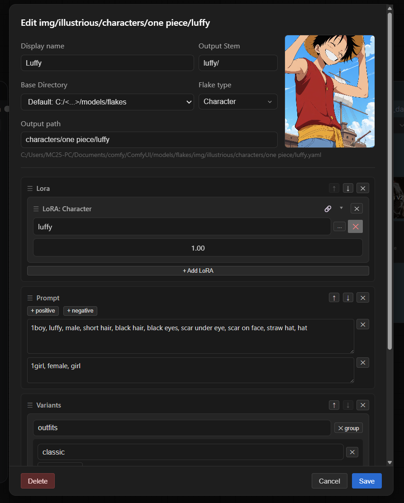
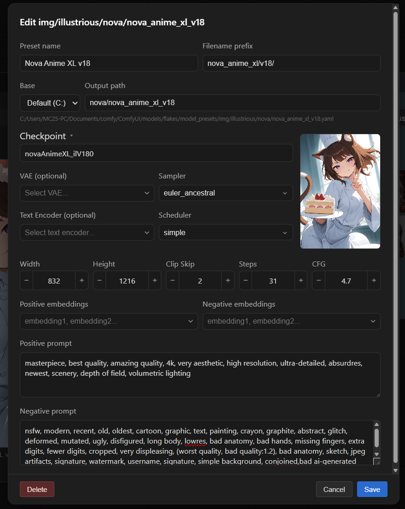
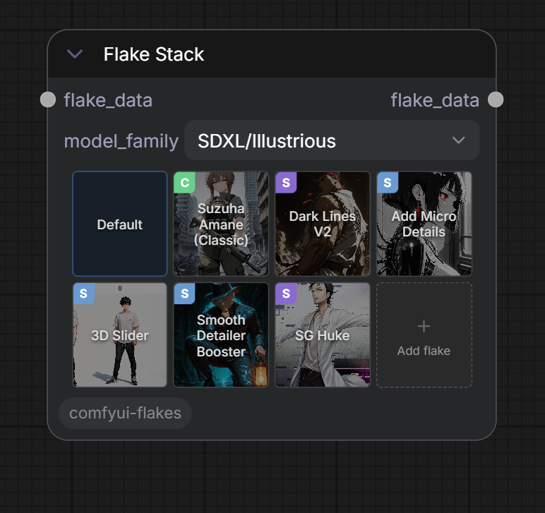
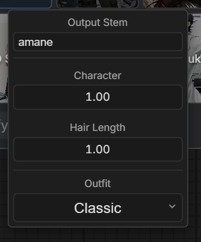

<div align="center">


**Reusable config presets — swap characters, styles, poses, checkpoints and more without rewiring your workflow**

ComfyUI Flakes is a set of nodes aiming to facilitate batch generation of images with reusable presets. Combine LoRAs, prompts, controlnets and more into a `flake.yaml` file that can be loaded, swapped, disabled and tweaked easily within the Flakes ecosystem. 



</div>

---

## Installation

**Via ComfyUI Manager** (Recommended)

Search for **ComfyUI Flakes** and click Install.

**Manual**

```bash
cd ComfyUI/custom_nodes
git clone https://github.com/JeyzerMC/comfyui-flakes
```

No extra dependencies — PyYAML is already part of ComfyUI's core.

---

## Flake file format

Flakes are reusable `.yaml` config files under `ComfyUI/models/flakes/`. They can represent any image generation concept, such as a character, a style, an environment, a pose, etc. Each flake has a number of different fields it can have that will be passed during the generation.

The only field required inside the YAML is `name` — the display label used everywhere in the UI. The flake's stable identifier is its filename relative to `models/flakes/` (subfolders included — `characters/musashi.yaml` is loaded as `characters/musashi`); that's the "output path" and lives in the filesystem rather than the file. Every other field below is optional — include only what your flake needs.

```yaml
# ─── Required ─────────────────────────────────────────────────────────────
name: "Miyamoto Musashi"        # Display name shown in the UI and pickers

# ─── Optional fields ──────────────────────────────────────────────────────

# Prompt fragments contributed to the stack. Either side can be omitted.
prompt:
  positive: "1boy, miyamoto musashi, long wild black hair"
  negative: "modern clothing, glasses"

# LoRAs — list of one or more entries. `path` is the model path under
# `models/loras/`; `name` and `url` are metadata for the picker / link icon.
loras:
  - name: "Musashi"
    url: "https://civitai.com/models/..."   # optional, shown as link icon
    path: "<lora_path>/musashi"                # under models/loras/
    strength: 0.9                           # default 1.0
    schedule:                               # optional hook schedule, see below
      - {start: 0.0, strength: 1.0}
      - {start: 0.6, strength: 0.0}

# Default resolution for the generation. The first flake in the stack that
# declares a `resolution` wins; otherwise it falls back to 1024 × 1024.
resolution: [832, 1216]

# Cover image shown on the flake's grid block and in the picker. Moved to
# `musashi/musashi.png` on save, or kept in place (`./musashi/...`) when it
# already lives in the flake's folder — see Portable flakes below.
cover_image: "<lora_path>/musashi.png"

# Variant groups — the UI lets you pick one choice per group. Each choice
# can contribute extra positive/negative text and an optional preview image.
# `default: true` on a group's first choice ("Applies by default" in the
# editor) applies it when the node leaves the group on "-"; pick "None" in the
# node's option panel to opt out.
variants:
  outfit:
    ronin:
      default: true
      positive: "tattered kimono, frayed hakama"
      negative: "armor"
      image: "<lora_path>/musashi_outfit_ronin.png"    # optional preview thumbnail
    shirtless:
      positive: "shirtless, hakama only"
  mood:
    calm:
      positive: "serene expression"
    fierce:
      positive: "battle stance, narrowed eyes"

# ControlNets — one entry per ControlNet to apply.
controlnets:
  - type: openpose                            # ControlNet category label
    model: control_openpose_xl.safetensors    # file under models/controlnet/
    image: standing_openpose                  # file under ComfyUI/input/
    strength: 0.8                             # default 1.0
    start_percent: 0.0                        # default 0.0
    end_percent: 1.0                          # default 1.0

# Filename stem injected into `Save Image`'s filename_prefix when this flake
# is in the stack. Multiple flakes' stems are joined with underscores.
output_stem: "musashi"

# Flake links — pull in one or more other flakes' loras + prompts when this
# flake is used. Each link can set default variant choices and lora-strength
# overrides for its target. (A single legacy `flake_link:` mapping is still
# read for backwards compatibility.)
flake_links:
  - target: "styles/ink_wash"          # another flake's output path
    variant:
      intensity: heavy                 # default variant choice on the target
    lora_strengths: [0.8]              # per-lora overrides (null = target default)
    variant_loras:                     # strengths for the LoRAs of a variant choice
      intensity: {heavy: [0.6]}        # {group: {choice: [strengths]}}
  - target: "poses/standing"
```

A flake can hold several prompts with `prompts:` instead of `prompt:` (a list of
`{positive, negative, schedule}` entries). Unscheduled prompts of one flake are
joined with `, `.

### Hook schedules

LoRAs, prompts and flake links take an optional `schedule`: keyframes that set
a strength multiplier from `start` (fraction of the denoising, 0–1) until the
next keyframe. Before the first keyframe the strength is 1. In the flake editor,
use **Add Hook Scheduler** from the card's ☰ menu.

- **LoRA**: scales the LoRA's model weights over time (core hook keyframes). Its
  text-encoder part stays on for the whole generation so trigger words encode.
- **Prompt**: encoded on its own and applied only where the strength is above 0.
- **Flake link**: multiplies into every LoRA and prompt the linked flake brings in.

Prompts are joined with `BREAK` between flakes so each flake acts as an independent CLIP region. LoRA strengths and variant choices can be overridden per-instance from the grid item's option panel without modifying the file on disk.

### Portable flakes

A flake owns the files it uses in a folder named after it, next to its yaml.
Saving `poses/jojo.yaml` moves its external data into `poses/jojo/` and points
the yaml at it with paths starting with `./` (relative to the yaml):

| Data | Stored as |
|---|---|
| Cover | `jojo/jojo.png` |
| LoRA (+ preview / `.civitai.info` sidecars) | `jojo/jojo_<display name>.safetensors` (`jojo.safetensors` when unnamed) |
| Variant choice image | `jojo/jojo_<group>_<choice>.png` |
| ControlNet image | `jojo/cnets/<image>.png` |

A ControlNet image brings its whole batch: picking
`001_pose_3_depthanythingv2.png` also moves every `001_pose_<n>_<token>` image
beside it.

The cover, ControlNet and variant images are picked in place with the file
picker, from `input/`, `output/`, `flakes/` or `models/`, so the originals are
what moves. An image already in the flake's own folder stays where it is: a
cover picked from `jojo/cnets/` is referenced there, and another ControlNet
image from that folder needs no move.

- Files are moved, or copied when the flake folder is on another disk. A file
  another flake uses is moved too, so that flake has to be re-pointed.
- Flake links are references and never move.
- Renaming or moving a flake in the editor takes its folder along.
- Deleting a flake keeps its folder.
- Existing flakes convert the next time they are saved.

Move the yaml and its folder together to share or relocate a flake.

#### Sharing through images

Images saved by Flake Generate carry the flakes and model presets that made
them (linked flakes included): their yaml, cover and folder files, without the
model weights. Dropping such an image into ComfyUI installs them, so only the
checkpoint and LoRA files have to be supplied.

- Nothing is overwritten: a flake or preset already present with the same yaml
  is reused, a different one with the same name installs as
  `<name> (imported)` and the loaded nodes point at it.
- Files go only into the flake's own folder under `models/flakes`.

### Editor helpers

- **Favorites**: the ☆ next to the editor title marks a flake as favorite
  (`favorite: true` in the yaml). Favorites show a ★ on grid items and in the
  flake picker.
- **Variant choices**: `→` between a choice's name and output stem fills the
  stem from the name (`Jojo Pose` → `jojo_pose`). A new choice gets the fields
  the group's choices already have (negative prompt, a ControlNet with the same
  settings minus the image, a LoRA row) and a name-derived stem when the others
  use theirs. A taken name becomes `Pose B`, `Pose C`, … Choice LoRAs have the
  same name/URL fields and -10…10 strength as the flake's own LoRAs.
- **Variant dropdowns** on grid items list `None` first, then the choices, with
  the default one marked `(default)` and preselected. On Flake Combo,
  `Multiple ↗` opens a grid to check several choices of a group; each checked
  choice is generated as its own combination. The slider + `Randomize` checks
  that many random choices (press again to re-roll).
  The dropdown also shows strength sliders for the LoRAs of the selected
  choice, stored per choice in the grid item (`variant_loras`).
- **Flake links**: the editor's link card and the grid dropdown's linked column
  show sliders for the LoRAs of the linked flake's selected variant choice
  (`flake_links[i].variant_loras`). A variant choice's own links (☰ →
  `Flake Link`) follow under a `<group>: <choice>` heading for the selected
  choice, overridden per choice in the grid item (`variant_link_overrides`).
- **ControlNets**: new entries have `img res` on. Picking a ControlNet image uses
  its batch's `_0_cover` image as the flake cover when it has none, and as the
  variant choice's image for a ControlNet inside a choice.
- **File pickers** show one drive at a time when your folders span several
  (C:, D:, …), starting on the extra model path drive. This includes the flake and
  preset pickers.



---

## Flake Model Preset

A Flake model preset is a config for checkpoints. Alongside the SDXL family it
supports Anima, Krea2 and Z-Image.



### Model families

The `model_family` dropdown picks both the on-disk layout (`img/<folder>/` under
`models/flakes/`, `models/flakes/model_presets/` and `output/`) and how the model
is loaded and sampled.

| Family | Folder | Model file | Text encoder | Encoder type | VAE |
|---|---|---|---|---|---|
| `SDXL/Base`, `SDXL/Illustrious`, `SDXL/Pony` | `sdxl`, `illustrious`, `pony` | all-in-one checkpoint | baked in | `STABLE_DIFFUSION` | baked in |
| `Anima/Base` | `anima` | `anima-base-v1.0` | `qwen_3_06b_base` | `QWEN_IMAGE` | `qwen_image_vae` |
| `Krea2/Turbo` | `krea2` | `krea2_turbo_fp8_scaled` | `qwen3vl_4b_fp8_scaled` | `KREA2` | `qwen_image_vae` |
| `ZImage/Base`, `ZImage/Turbo` | `zib`, `zit` | `z_image_turbo_bf16` | `qwen_3_4b` | `LUMINA2` | `ae.safetensors` |

SDXL presets need only a **Checkpoint**. The other families ship as a bare
diffusion model, so they also need a **Text Encoder**, its **Text Encoder Type**
and a **VAE**. Point the preset at either a **Checkpoint** or a **Diffusion
Model** — a UNET-only file that happens to live in `models/checkpoints/` is
detected automatically, so you don't have to move it.

Presets seed their sampler defaults from the family (Z-Image and Krea2 Turbo: 8
steps at CFG 1; Anima base: 30 steps at CFG 4 with Euler Ancestral / Normal). At CFG ≤ 1 the negative prompt is
zeroed out, matching how distilled models are sampled. **Clip Skip** is hidden
for the Qwen-based families, where it does not apply.

A preset can also carry **LoRAs** and **Flake Links** (sections at the bottom of
the preset editor, same format as in a flake). They apply whenever the preset is
used, before any flake LoRAs.

> Anima, Krea2 and Z-Image require **ComfyUI v0.34 or newer**. Their
> architectures and the `KREA2` encoder type do not exist in older releases.

### ControlNets for Anima and Z-Image

A flake's ControlNet field works the same for every family: pick an image, a
type, then tweak strength, start and end. Anima and Z-Image don't use regular
ControlNets, though. Their ControlNets are **model patches** that hook the
diffusion model, so the files go in `models/model_patches/`, not
`models/controlnet/`:

| Family | Folder | Files | Types |
|---|---|---|---|
| `Anima/Base` | `models/model_patches/anima/` | `anima-lllite-{pose,depth,lineart,scribble}-1` ([Comfy-Org/Anima-LLLite](https://huggingface.co/Comfy-Org/Anima-LLLite)) | openpose, depth, lineart, scribble |
| `ZImage/Base`, `ZImage/Turbo` | `models/model_patches/zimage/` | `Z-Image-Turbo-Fun-Controlnet-Union` (any version) | openpose, depth, canny, softedge |

- Anima depth expects a Depth Anything V2 map (white = near). The pose model is
  noticeably weaker than depth; for locking a pose, depth works better.
- The Anima LLLite weights are Preview3 releases and lose some quality on Anima
  Base v1.0.
- Z-Image's Fun ControlNet has no start/end: it applies to every step.
- [TaihoC/Anima-ControlNet-VACE-Depth](https://huggingface.co/TaihoC/Anima-ControlNet-VACE-Depth)
  is not supported by core ComfyUI. Install the
  [ComfyUI-Advanced-ControlNet-Anima](https://github.com/TaihoC/ComfyUI-Advanced-ControlNet-Anima)
  fork (branch `feat/anima-vace-controlnet`), put the file in
  `models/controlnet/anima/` and select it in the ControlNet entry's Model dropdown.
- For Anima, the Model dropdown lists every file in `models/model_patches/anima/`
  and the VACE files in `models/controlnet/anima/`. `Auto (by type)` uses the
  LLLite file for the type; a model that no longer exists falls back to Auto.
- If an Anima ControlNet seems to have no effect, check the console:
  `[flakes] Anima lllite <file> ... sigma=<start>..<end>` per applied patch and
  `[FlakeGenerate] model patches: post_input=1, ...` before sampling (`none` means
  no patch reached the sampler). To compare, run ComfyUI's
  `Control to Image (Anima LLLite)` blueprint with the same image, file,
  strength, start/end, seed and sampler settings.
- The base model is not reloaded when switching flakes. Each patch is a hook on
  a clone that shares its weights, and recently used patch files stay cached.

---

## Flake Animate

Image-to-video with its own presets and nodes: **Flake Animate Preset** /
**Preset Combo** load an animate preset into a `flake_anim_data` pin, **Flake
Animate Stack** / **Combo** add flakes, and **Flake Generate Animation** samples
it and saves an MP4 to `output/anim/<family>/`. Start images belong to the grid
items (bottom-left `+` / count button); each image queues its own video.

| Family | Folder | Models | Text encoder type | VAEs |
|---|---|---|---|---|
| `Wan 2.2` | `wan22` | high-noise + low-noise diffusion models | `WAN` | Wan VAE |
| `MiniMax H3` | `mh3` | one diffusion model | `MINIMAX` | video VAE + audio VAE |

All files load with ComfyUI's core loaders (diffusion models, text encoders,
VAEs), so they go in the usual `models/` folders. Wan 2.2 LoRAs take a high and
a low file. MiniMax H3 videos are 24 fps with generated audio.

Flake Generate Animation:

- The video's short edge comes from the preset's resolution (480p / 580p /
  720p) and its aspect from the start image; both sides round to a multiple of 32.
- **upscale** + **upscale_model** (`models/upscale_models/`) upscales every frame.
- **interpolate** + **interpolation_model** (`models/frame_interpolation/`, RIFE
  or FILM) doubles the frame count and the fps.
- **use_headroom** + **headroom** keeps that many GB of VRAM free while sampling
  and decoding.
- Each field shows only while its toggle is on; a toggle on with no model
  selected is an error.

---

## Nodes

### Flake Stack

Sits between your checkpoint loader and sampler. Loads an ordered list of **flakes** (YAML presets), merges their prompts and LoRAs, and outputs everything the sampler needs.



Flakes can be reordered, enabled / disabled, and edited, and dragged and dropped between Flake Stack / Flake Combo nodes in any direction. You can also open a small dropdown menu to make small non-persistent tweaks, such as changing a variant option, or a lora strength.

<div align="center">



</div>

### Flake Combo

TODO

### Flake Model Preset

TODO

### Flake Model Combo

TODO

### Flake Generate

Samples, decodes and saves the stack. While a combination is sampling, the node
and its Generation Data overlay show the live step preview, including the
ADetailer pass (upscaling has no steps to preview). When ComfyUI's **Live preview
method** setting is `default` and the server runs without `--preview-method`,
Flakes requests `auto` (latent2rgb) previews for its prompts; pick `taesd` for
sharper previews or `none` to turn them off. Combinations that are not generated
yet show their flakes' covers as scattered cards that fill the image panel (a
choice without an image uses its flake's cover). Results stay matched to their
grid item when items are moved or duplicated. **Fit Output Image in View** (top
right of the overlay, on by default) fits the whole image in view; off, it shows
at full size and scrolls both ways. Landscape outputs widen the overlay to
nearly the screen width. Prompts,
LoRAs and model details are folded under the `^` at the bottom of each panel.

### Flake Inpaint

Insert it right before Flake Generate to redraw part of an image with the
chain's model, LoRAs and prompt. Load the image on the node and paint the area
to redraw with ComfyUI's mask editor (right-click → Open in MaskEditor). The
image's size replaces the chain resolution.

- **denoise** `1.0` fills the masked area from scratch (grown by `grow_mask`);
  below `1.0` it keeps the original as a starting point. Flake Generate samples
  at this denoise.
- Without a mask the whole image is redrawn at `denoise` (img2img).
- `positive_prompt` / `negative_prompt` are appended to the chain prompt.

To fix an image Flakes made, drop it into ComfyUI to restore its workflow,
insert Flake Inpaint before Flake Generate and load the same image.

### Flake Data Split

TODO 

---

## Roadmap

- Flux support
- Video support (Starting with WAN)
- Post Process (ADetailler / Upscalers)
- IP Adapters
- LoRA training
- Controlnet preprocessing
- Variant LoRAs? 

Fill free to open an issue if you'd like more features supported by Flakes.

---

## Changelog

See [CHANGELOG.md](CHANGELOG.md) for the full release history.

---

## License

[MIT](LICENSE)
